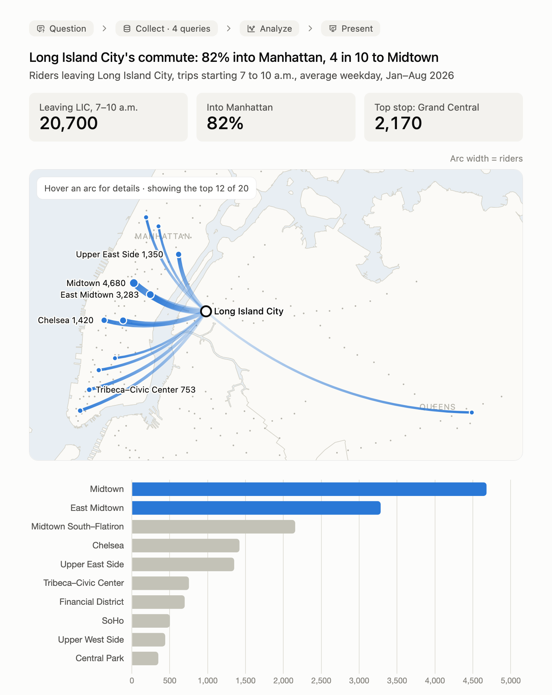
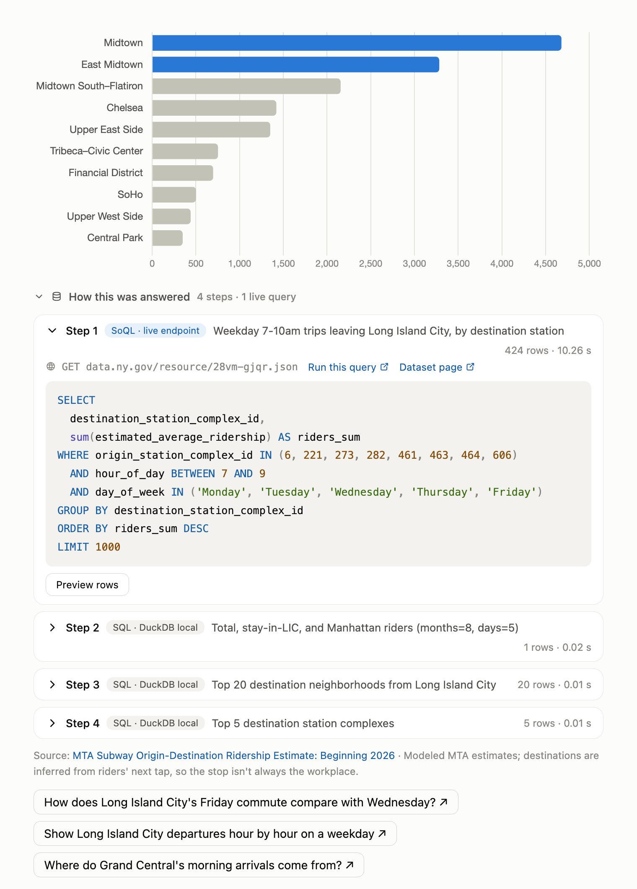
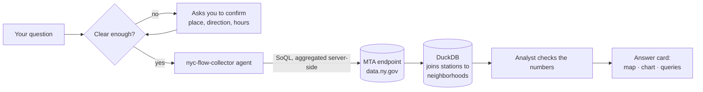

# NYC Flow Analyst

**Ask where New Yorkers travel by subway, right inside Claude Code.**

NYC Flow Analyst is a [Claude Code](https://claude.com/claude-code) plugin that
turns Claude into a data analyst for the MTA's subway origin-destination data.
Ask a question in plain English and get back real numbers from the live MTA
dataset, an interactive chart, a flow map, and every query that produced them.



> **You:** I want to know the commuting pattern
>
> **Claude:** *Commuting where? Which part of the pattern? Which hours?*
> (It asks before it queries.)
>
> **You:** Long Island City, where people go, morning peak
>
> **Claude:** About 20,700 riders leave Long Island City between 7 and 10 a.m.
> on an average weekday, and 82% of them head into Manhattan. Nearly 4 in 10 go
> to just two neighborhoods: Midtown and the Grand Central area…

## What you get

- **Answers from live data.** Every number comes from a query against
  [data.ny.gov](https://data.ny.gov/d/28vm-gjqr), about 83 million trip
  estimates from January 2026 onward. No made-up figures.
- **The work, shown.** Each answer lists its queries with the live endpoint,
  a "Run this query" link, row counts, and timings. The SQL is formatted and
  syntax-highlighted. Steps start collapsed, so open them when you want them.
- **A map when it matters.** Questions about where trips go or come from get
  a flow map over real borough outlines: arcs fade in toward each destination,
  hover shows riders and share of trips, and buttons switch between days.
- **Charts that fit the question.** Ranked bars for destinations, hourly
  lines for daily rhythm, and side-by-side bars for comparisons.
- **It asks before guessing.** Vague questions ("commuting pattern", "at
  night") get a short confirmation (where, which direction, which hours)
  before any query runs.
- **It stays on topic.** It only answers from this dataset and says so when a
  question is out of scope.



## Install

You need [Claude Code](https://claude.com/claude-code) and
[uv](https://docs.astral.sh/uv/) (which runs the Python tool and installs
DuckDB on first use). No API keys.

In Claude Code:

```
/plugin marketplace add nniishhh/nyc-flow-analyst
/plugin install nyc-flow-analyst@nyc-flow-analyst
```

Or from a terminal:

```bash
claude plugin marketplace add nniishhh/nyc-flow-analyst && claude plugin install nyc-flow-analyst@nyc-flow-analyst
```

Start a new session afterward so the skill and its agent load.

<details>
<summary>Install without the plugin system</summary>

Copy the skill and agent into your Claude folder:

```bash
git clone https://github.com/nniishhh/nyc-flow-analyst
cp -r nyc-flow-analyst/skills/nyc-flow-analyst ~/.claude/skills/
cp nyc-flow-analyst/agents/nyc-flow-collector.md ~/.claude/agents/
```

</details>

## Try it

Type `/nyc-flow-analyst` followed by a question, or just ask:

- *Where do Long Island City riders go on a weekday morning?*
- *Where do Williamsburg riders go after 10 p.m. on Saturday?*
- *Across the city, where do people go after 10 p.m. on a Saturday?*
- *Show Flushing departures hour by hour, Saturday vs Wednesday.*
- *How much quieter is the Financial District on Friday than on Wednesday?*
- *What are the busiest origin stations on an average Sunday?*
- *Which stations do people arriving at Grand Central come from, 7 to 10 a.m.?*
- *Which station-to-station trips are busiest on a Friday night?*

The answers render as interactive cards in the Claude desktop app and on
claude.ai. Ask *"make this a presentation"* to turn a conversation's findings
into a slide deck.

## How it works



1. **Confirm.** The analyst checks it knows *where*, *which direction*,
   *when*, and *compared with what*, and asks if not.
2. **Collect.** A collector agent writes
   [SoQL](https://dev.socrata.com/docs/queries/) so the MTA's servers do the
   heavy aggregation over 83M rows, then rolls stations up to neighborhoods
   locally with DuckDB.
3. **Check.** The analyst sanity-checks totals and shares before answering.
4. **Present.** `nyc.py card` builds the answer card from a small spec plus
   the logged queries, so the card always shows exactly what ran.

## Make it yours

Everything is plain text you can edit:

| File | What it controls |
|---|---|
| [`SKILL.md`](skills/nyc-flow-analyst/SKILL.md) | How the analyst behaves: scope, when to ask, tone, which chart to use |
| [`data-dictionary.md`](skills/nyc-flow-analyst/data-dictionary.md) | What it knows about the data: columns, averaging rules, neighborhood names, caveats |
| [`card.html`](skills/nyc-flow-analyst/card.html) | How answers look: map, charts, formatted SQL |
| [`nyc-flow-collector.md`](agents/nyc-flow-collector.md) | How the query agent works and what it reports back |
| [`nyc.py`](skills/nyc-flow-analyst/nyc.py) | The one tool: runs queries, logs them, builds cards |
| [`stations.csv`](skills/nyc-flow-analyst/stations.csv) | Every station complex and its neighborhood |

Results and cards are cached in `~/.cache/nyc-flow-analyst` (set
`NYC_FLOW_CACHE` to move it). If you query a lot, a free
[Socrata app token](https://dev.socrata.com/docs/app-tokens.html) in
`SOCRATA_APP_TOKEN` raises the rate limit.

## About the data

- **Trips:** [MTA Subway Origin-Destination Ridership Estimate: Beginning 2026](https://data.ny.gov/d/28vm-gjqr),
  New York State Open Data. These are **modeled estimates**, not counted
  journeys. The MTA infers each destination from a rider's next MetroCard or
  OMNY tap, because the subway records no exits. Values are averages for each
  weekday and hour within a month.
- **Neighborhoods:** stations are grouped into NYC Planning's 2020
  [Neighborhood Tabulation Areas](https://data.cityofnewyork.us/d/9nt8-h7nd),
  with names shortened to everyday use.
- **Map outlines:** NYC borough boundaries via Code for America's
  [click_that_hood](https://github.com/codeforamerica/click_that_hood) (MIT).

## License

[MIT](LICENSE). Built by [Oranich Jamkachornkiat](https://techgirl.nyc). The
skill grew out of [Where does New York go?](https://techgirl.nyc/projects/nyc-flow),
an interactive look at the same data.
